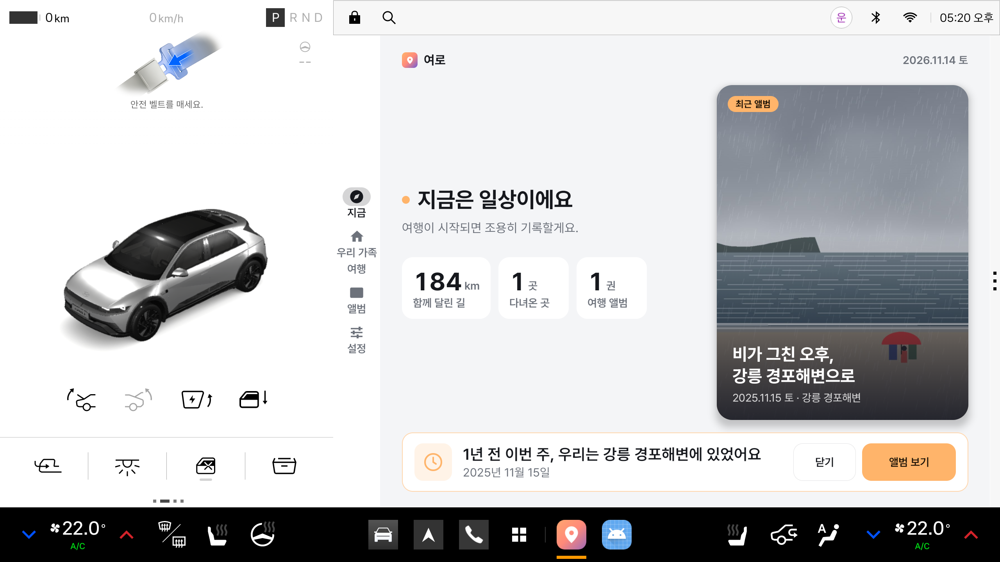
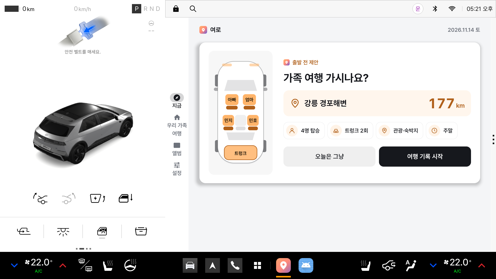
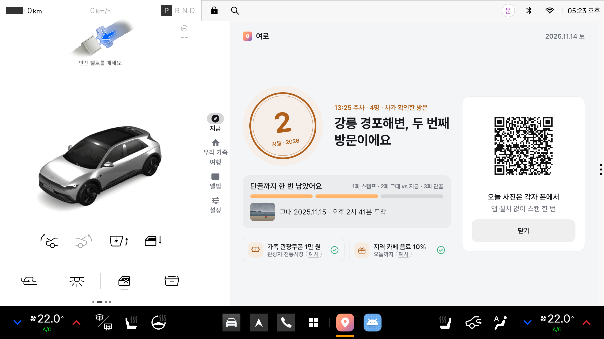
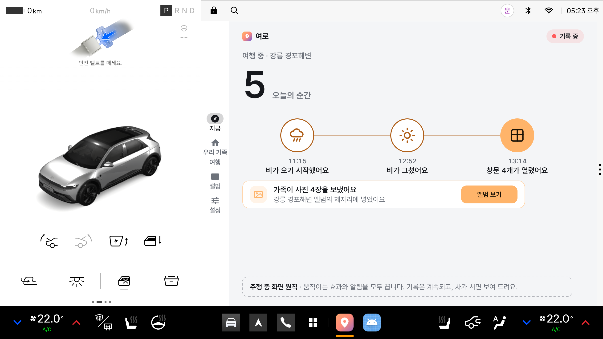
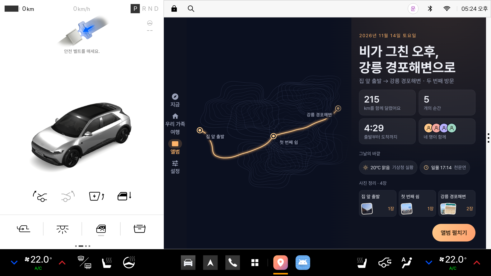
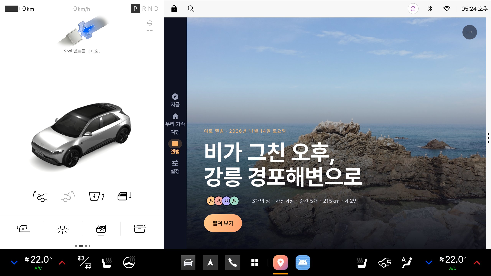
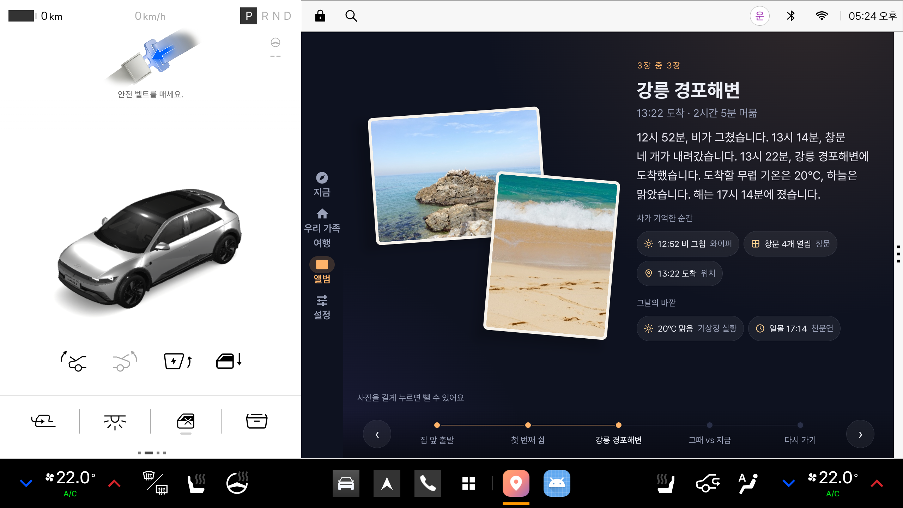
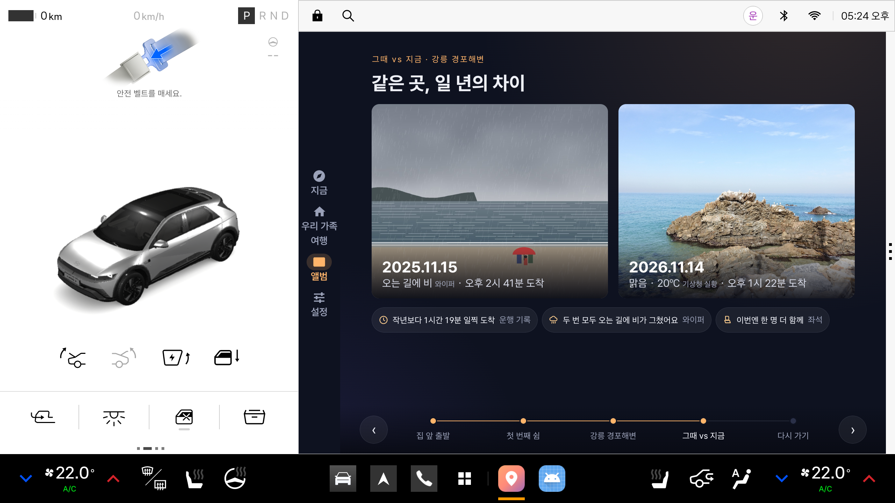
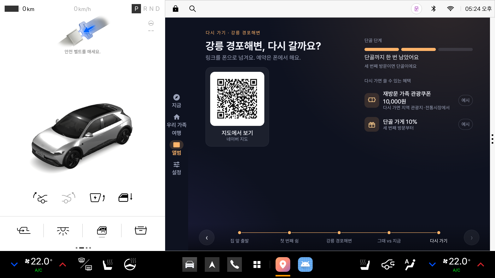
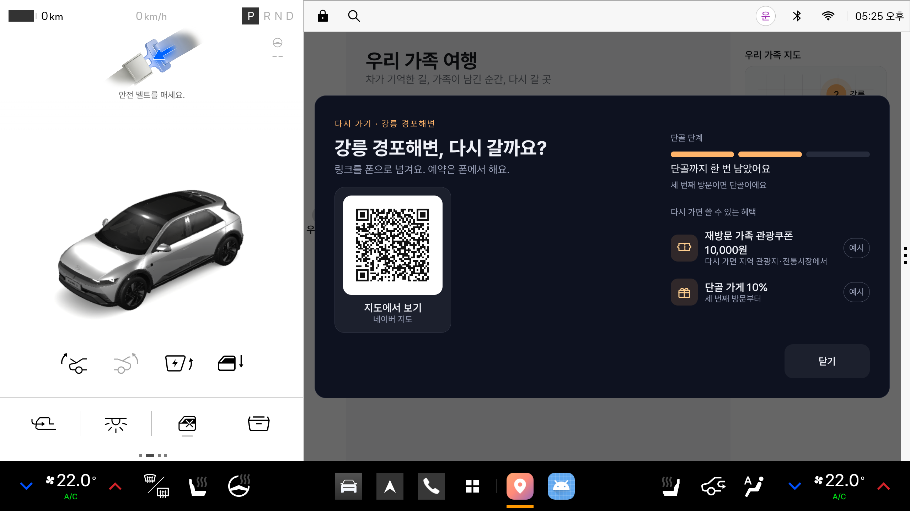

# 여로 — 가족 여행을 기억하는 차

여로는 Pleos Connect(Android Automotive OS 14) 차량용 앱입니다. 좌석·트렁크·기어·와이퍼·창문·내비 신호로 "오늘은 가족 여행"인지 스스로 판단하고, 출발 전에 한 번만 묻고, 달리는 동안에는 조용히 기록합니다. 목적지에 서면 차가 도착을 확인하고, 집에 돌아오면 그날의 길과 순간을 앨범 한 권으로 보여 줍니다. 카메라는 쓰지 않고, 차가 이미 아는 신호만 씁니다. 도착하면 차가 한 번 소리로 알려 주고, 원하면 출발 질문에 말로 답할 수 있습니다(Pleos 온디바이스 음성, 기본 꺼짐).

## 제출 정보 (심사용)

| 항목 | 내용 |
|---|---|
| 앱 | 여로: 가족 여행을 차가 기억하는 앨범 |
| APK | [`apk/엠베이스_여로_release.apk`](apk/엠베이스_여로_release.apk) (서명된 release, 패키지 `ai.yeoro`, minSdk 28) |
| 에뮬레이터 | Pleos Connect Emulator **v2.1.0** (`system-images;android-34;pleos_car_emulator;arm64-v8a`, Android Automotive OS 14), 앱 사용자 10 |
| 화면 규격 | **2560×1440, 160dpi** (가로) |
| 차량 신호 입력 | Virtual Console `http://127.0.0.1:8088` (기어·좌석·도어·트렁크·와이퍼·창문) |
| 설치 | `adb install -r --user 10 apk/엠베이스_여로_release.apk` → 런처의 "여로" |

release APK는 처음 켜면 기록 동의 화면이 나오고, 동의하면 "지금은 일상이에요"에서 차 신호를 기다립니다. 위치·여행 장면을 몇 분 안에 재연하는 시연 장치(시계 앞당기기·샘플 경로)는 디버그 빌드에만 있으므로, 전체 흐름은 아래 "실행"의 `scripts/scenario_demo.sh`(디버그 빌드)나 시연 영상으로 확인할 수 있습니다. API 키(Supabase publishable 키)는 저장소에 없고 APK에만 들어 있습니다.

## 다섯 단계

| 단계 | 차에서 일어나는 일 | 상태 |
|---|---|---|
| 떠나기 | P단에서 좌석 4석·트렁크 두 번·먼 목적지(관광·숙박지면 +20) → "가족 여행 가시나요?" 한 번 묻기(말로 답해도 됨) | 구현 |
| 달리기 | 주행 중에는 움직임 없는 화면 하나. 비·창문·쉬어 간 곳을 조용히 기록 | 구현 |
| 머물기 | 목적지 300m 안에서 P단 2분 → 도착 인증 카드(스탬프·단골 단계·두 번째 방문이면 그때 줄·사진 올리기 QR)와 도착 인사(TTS) | 구현 (혜택은 예시) |
| 기억하기 | 가족이 QR로 올린 사진이 촬영 시각대로 제자리에 → 집에 돌아와 여행이 닫히면 앨범 공개(그날의 실제 날씨·일몰·축제) → 표지 → 장 넘기기 | 구현 |
| 다시 가기 | 책장·가족 지도·정기 방문, 그때 vs 지금, 다시 가기 QR(지도·홈페이지를 폰으로), 1년 전 이번 주 회상 카드 | 구현 (혜택은 예시) |

### 2b 상태 (클라우드와 기억)

| 기능 | 상태 | 비고 |
|---|---|---|
| 여행 등록·삭제(`trip`) | 완료 | 도착 카드 QR을 띄운 여행만, 기기 비밀 sha256 |
| 휴대폰 사진 올리기(`upload` + 정적 페이지) | 완료 | 실제 폰으로 여러 장·EXIF·세로 사진 확인(2026-10-28), 올린 사람이 지우기 |
| 차가 사진 받기(`photos`) | 완료 | 촬영 시각으로 장에 넣기, 표지·콜라주, 지금 화면 "가족이 사진 N장을 보냈어요" |
| 그날의 바깥(`outside`: 기상청·천문연·TourAPI) | 완료 | 날씨·일몰·축제·공휴일 칩과 기록문, 목적지 종류를 판단 엔진에 |
| 왕복 여행 | 완료 | 돌아오는 길은 앨범 한 장(흐린 귀갓길 선) |
| 그때 vs 지금 | 완료 | 두 번째 방문부터 도착 카드와 앨범 한 쪽 |
| 다시 가기·1년 전 이번 주 | 완료 | 네이버 지도·홈페이지 QR, 회상 카드 하루 한 번 |
| 음성(도착 인사·말로 답하기) | 완료 | Pleos 온디바이스 TTS·STT |
| AI 여행 기록문(`diary`) | 만들지 않음 | 선택 기능. 서버에 없으면 스모크는 "AI 꺼짐"으로 통과, 앨범은 차 안 규칙 기록문 그대로 |
| 혜택(관광쿠폰·단골 가게) | 예시 | 화면에 "예시"로 표시 |

## 상황 판단 엔진 (`:engine`, 순수 Kotlin)

- 신호마다 점수를 더합니다. 목적지 150km 이상 +35, 뒷좌석 2명 이상 +20, 출발 전 트렁크 +15, 주말 +10, 혼자 탑승 −15, 평일 출퇴근 시간 −10 등.
- **70점 이상**: 확신 → 출발 전에 묻습니다(하루 한 번까지). **40~69점**: 후보 → 묻지 않고 조용히 남겨 두었다가 나중에 확인합니다. **40점 미만**: 일상 → 기록하지 않습니다.
- 비 순간(RAIN_START)은 와이퍼가 켜지기 전 30분 이상 꺼져 있었고, 켜진 뒤 3분 넘게 이어질 때만 기록합니다. 끄고 10분 넘게 지나면 비 그침입니다.
- 화면 알림은 **기어 P에서만** 띄웁니다. 주행 중(UX 제한)에는 애니메이션·자동 스크롤·알림이 없습니다. 앨범은 주행 중에 제목·날짜·곳만 보이는 정적 요약으로 바뀌고, 차를 세우면 보던 자리로 돌아갑니다(등장 연출은 다시 돌지 않음). 확인 안 한 여행의 [지우기]는 주행 중에 막히고, P단에서는 한 번 더 확인합니다.
- 여행은 집 근처 P단 120분(귀가) 또는 7일이 지나면 닫힙니다.

## 개인정보

- 기록 동의는 **기본 꺼짐**입니다. 첫 실행 동의 화면이나 설정에서 켜기 전에는 판단도 기록도 하지 않고, 지금 화면은 "여로 기록이 꺼져 있어요"를 보입니다(여행 중에 꺼도 바로). 주행 중에는 설정을 바꿀 수 없습니다(차를 세우면 바꿀 수 있음).
- 여행이 아닌 일상 운행 기록은 **24시간 뒤 삭제**합니다.
- 얼굴 인식·음성 녹음·카메라는 쓰지 않습니다. 마이크는 설정의 "출발 질문에 말로 답하기"를 켰을 때만, 출발 질문이 지금 화면에 보일 때 질문 뒤 6초 동안 열리고(화면에 "듣고 있어요"), 음성은 차 안에서 처리하고 저장하지 않습니다. 사진은 가족이 직접 올린 것만 앨범에 들어갑니다.
- 위치 경로·좌석·순간 같은 기록은 차 안(기기 DB)에만 있습니다. **차 밖으로 나가는 것**은 아래뿐이고, 동의 화면과 설정에 같은 목록이 보입니다.
  - 사진 올리기를 위해 여행 등록: 공유 토큰, 출발 시각, 목적지 이름, 이 차의 기기 확인 값(설치마다 만든 무작위 기기 비밀, 서버에는 sha256만 저장). 지나온 길(위치 기록)은 보내지 않습니다. (도착 카드의 QR을 띄운 여행만)
  - 사진: 가족이 QR로 직접 올린 사진만 받습니다. 서버에는 30일(+정리 7일)까지만 둡니다.
  - 날씨·일몰·관광 정보: 목적지 좌표와 도착 시각(예보 발표 시각을 고르는 데 씀)으로 기상청·천문연·한국관광공사에 물어봅니다(우리 서버 함수를 거쳐서).
  - 여행을 지우면 차 안에서는 바로 지우고, 동의가 켜져 있을 때 서버의 사진과 등록도 함께 지웁니다(P단이 아니거나 네트워크가 없으면 차에 남긴 삭제 큐로 다음 동기화 때, 동의가 꺼져 있으면 다시 켤 때까지 큐에만 두고 서버는 30일 만료 뒤 정리). 기록 동의를 끄면 아무것도 보내지 않습니다(네트워크 호출 0회).
- 서버 호출은 차가 P단일 때(도착·주차 중 10분마다)와 여행을 닫을 때만 합니다. 주행 중에는 부르지 않습니다. 호출마다 바로 앞에서 동의와 기어를 다시 보므로, 도중에 동의를 끄거나 D로 바꾸면 그다음 호출부터 멈춥니다. 기어를 모를 때(UNKNOWN)는 릴리스 빌드에서는 부르지 않고, 디버그 빌드만 허용합니다(에뮬레이터용). 서버에는 기기 비밀의 sha256만 있고, 그 비밀을 가진 이 차만 사진 목록을 보거나 여행을 지울 수 있습니다.

## 음성 (Pleos TTS·STT)

음성은 덧붙이는 길입니다. 꺼져 있거나 실패해도 카드·알림·터치는 그대로 동작합니다.

- **도착 인사(TTS, 기본 켜짐)**: P단에서 도착 카드가 뜰 때 카드 제목("강릉 경포해변, 두 번째 방문이에요")을 한 번 말합니다.
- **출발 질문에 말로 답하기(STT, 기본 꺼짐)**: 켜면 마이크 권한(RECORD_AUDIO)을 묻고, 거절하면 꺼진 채로 둡니다. 지금 화면이 보일 때만(알림으로만 전한 질문은 소리로 묻지 않고, 화면이 다시 보이면 그때 한 번 묻습니다. 화면이 가려지면 듣기를 멈춥니다) 출발 질문("가족 여행 가시나요?")을 말한 뒤(말이 끝난 뒤에만) 6초 듣고, 최종 문장을 보수적으로 해석합니다("응·네·여행·가자…" 수락(응·네·예·어는 낱말 전체일 때만), "아니·그냥·됐어…" 거절, "안 좋아"·"기록하지 마"처럼 부정이 붙은 수락은 모름, "안 갈래"처럼 부정만 있으면 거절, 둘 다 있거나 없으면 모름). 알아들으면 카드 터치와 같은 답 경로(`EngineBus.answer`)로 보내고, 모르면 아무것도 하지 않습니다(카드로 답하면 됨). 다시 묻지 않습니다. 소급 질문은 소리로 묻지 않습니다.
- P단·기록 동의 켜짐일 때만. 기어가 P를 벗어나거나 카드·질문이 사라지면 말하기·듣기를 바로 멈춥니다.
- `Mode.ON_DEVICE`만 씁니다: 앱 등록·키·네트워크가 필요 없고 음성이 차 밖으로 나가지 않습니다. 설정이 꺼져 있으면 음성 서비스(caas)에 붙지도 않습니다.
- 쓰는 Pleos Playground SDK: `Vehicle 2.3.2`(좌석·기어·트렁크·와이퍼·창문), `NaviHelper 3.0.5`(목적지·위치·도착), `TextToSpeech 3.3.1`, `SpeechToText 3.3.1`.
- 에뮬레이터 마이크로는 소리가 들어오지 않아(호스트 마이크 연결은 Extended Controls 수동 설정) 디버그 빌드는 답을 PCM으로 넣습니다: `scripts/dbg.sh --es voice_pcm yes|no|maybe|off`(`scripts/make_voice_pcm.sh`로 만든 "응, 여행이야" 등), `--es voice_say '<문장>'`, `--es voice_guide|voice_answer true|false`. 확인은 `scripts/scenario_voice.sh`.

## 시연 장면

`scripts/scenario_demo.sh`가 에뮬레이터에서 한 번에 재연한 장면입니다(스크린샷 `docs/screens/2b/`). 샘플 경로(서울 마포 → 영동고속도로 → 강릉 경포해변)를 위치 신호로 흘려 넣고 시계를 앞당겨 4시간 반짜리 여행을 약 5분에 재연합니다. 앨범은 **이 시연에서 실제로 기록된 여행**이고(위치 샘플·순간을 DB에 직접 넣지 않음), 사진은 시연 중에 실제 서버로 올린 4장, "그날의 바깥"은 실제 공공데이터 응답입니다. 미리 넣는 것은 1년 전 지난 방문 한 건(`seed_prev`, 회상 카드·그때 vs 지금용)뿐입니다.

| # | 장면 | 화면 |
|---|---|---|
| 0 | 1년 전 이번 주: 일상 P단의 회상 카드(지난 방문 사진 1장) |  |
| 1 | 일상: 판단 엔진이 조용히 점수만 매김 | [demo-01](docs/screens/2b/demo-01-daily.png) |
| 2 | 떠나기: 강릉 177km +35 · 목적지 관광·숙박지 +20(TourAPI) · 뒷좌석 2명 +20 · 트렁크 2회 +15 · 주말 +10 → 100점, 출발 전 제안 |  |
| 3 | [여행 기록 시작] → 좌석이 하나씩 켜지고 경로가 그려짐 | [demo-03](docs/screens/2b/demo-03-start.png) |
| 4 | 달리기: 정적 기록 화면 ("4명이 함께 출발했어요") | [demo-04](docs/screens/2b/demo-04-driving.png) |
| 5 | 휴게소 38분 정차 (P단 + 문 열림) | [demo-05](docs/screens/2b/demo-05-rest.png) |
| 6 | 비: 와이퍼 3분 넘게 → 비 시작, 10분 넘게 꺼짐 → 비 그침 | [demo-06](docs/screens/2b/demo-06-rain.png) |
| 7 | 창문 네 개 열림 | [demo-07](docs/screens/2b/demo-07-windows.png) |
| 8 | 머물기: 경포해변 P단 → 도착 인증 카드 "두 번째 방문" + 그때 줄, 도착 인사(TTS), 여행 등록·바깥 받기 |  |
| 8b | 가족이 QR로 사진 4장 올림(`scripts/demo_upload.sh`, 08:50·10:05·13:30·14:10 촬영) → 차가 받아 "가족이 사진 4장을 보냈어요" |  |
| 9 | 귀가 규칙으로 여행 닫힘 → "앨범이 준비됐어요" | [demo-09](docs/screens/2b/demo-09-saved.png) |
| 10 | 앨범 공개: 실제 날씨(기상청 실황)·일몰(천문연) 칩, 사진 정리 줄(장마다 몇 장) |  |
| 11 | 표지: 실제 사진 |  |
| 12 | 장: 출발 · 첫 번째 쉼 · 경포해변(사진 콜라주, 기록문 끝에 바깥 문장) | [출발](docs/screens/2b/demo-13-chapter-depart.png) · [쉼](docs/screens/2b/demo-14-chapter-rest.png) ·  |
| 12b | 그때 vs 지금: 1년 전 방문과 도착 시각·날씨·인원 비교 |  |
| 12c | 다시 가기: 네이버 지도 QR, 단골 단계, 혜택(예시) |  |
| 13 | 우리 가족 여행(책장·가족 지도·단골 단계) | [demo-16](docs/screens/2b/demo-16-home.png) |
| 14 | 정기 방문: 강릉 경포해변 2번 → [다시 가기] 대화상자 |  |

시연 사진 4장은 Wikimedia Commons의 CC0 사진입니다: [출처](scripts/demo_photos/CREDITS.md). 2a 시연(클라우드·지난 방문 없음)의 장면은 `docs/screens/2a/demo-*.png`에 있습니다(`DEMO_PREV=0 DEMO_SHOT_DIR=docs/screens/2a`).

**TourAPI 데이터 변화(2026-11)**: 2026년 11월부터 TourAPI 위치 기반 목록이 경포해변 근처 관광지(분류 12) 행을 돌려주지 않아, 서버 응답의 가까운 장소 이름(`place.name`)이 비어 있습니다. 목적지 종류(관광지)는 그대로 나와 제안 점수 +20은 유지됩니다. 앱은 장소 이름에 기대지 않고 내비 목적지 이름("강릉 경포해변")을 제목·장·카드에 쓰므로 화면에 빈칸이 생기지 않습니다(이름은 다시 가기의 홈페이지 QR 라벨에만 쓰고, 없으면 목적지 이름으로 갈음). 축제·일몰·날씨는 영향이 없습니다(시연 날짜 근처에 강릉 축제가 없으면 축제 칩은 나오지 않습니다).

그 밖에: [동의 꺼짐의 지금 화면](docs/screens/2a/live-consent-off.png), [앨범 준비](docs/screens/2a/live-album-ready.png), [주행 중 앨범(정적 요약)](docs/screens/2a/album-driving.png), [확인 안 한 여행 지우기 확인](docs/screens/2a/home-delete-confirm.png) · [주행 중에는 지우기 막힘](docs/screens/2a/home-delete-driving.png), [주행 중 설정(읽기 전용)](docs/screens/2a/settings-driving.png), [좁은 창의 앨범](docs/screens/2a/split-album.png) · [스크롤](docs/screens/2a/split-album-scrolled.png), [좁은 창의 홈](docs/screens/2a/split-home.png).

**근처 혜택 → 쿠폰 → 예약 (컨셉, 제휴 사업 모델)**: 도착 카드의 혜택 칸을 누르면 "근처에서 쓰기"가 열립니다. 재방문 가족 관광쿠폰, 바다 앞 식당 4인 세트, 지역화폐 가맹점을 차를 세운 곳 기준 거리와 함께 보여 주고, 식당을 고르면 **차가 확인한 탑승 인원(좌석 신호)으로 인원이 미리 채워진** 예약 화면 → 시간 선택 → 예약 요청 → 쿠폰이 붙은 예약 티켓과 길안내(NaviHelper `requestRoute`)로 이어집니다. 지자체·한국관광공사·지역 가게와 제휴하면 이 자리에 실제 혜택과 예약이 들어오는 구조를 보여 주는 화면으로, 지금은 서버·제휴처 없이 **가상의 가게 이름과 예시 값**만 씁니다(화면에 "제휴 시 제공 · 예시"). P단에서만 보이고 P를 벗어나면 닫힙니다. 실제 데이터로 이을 수 있는 공공 API로는 한국조폐공사 지역화폐 가맹점 정보가 있습니다. 시연: `scenario_demo.sh` 장면 08c, `dbg.sh --es nearby open|reserve|time:18:30|request|close`.

**예시·자리표시 데이터** (화면에 "예시"로 표시): 도착 카드와 다시 가기의 혜택(관광쿠폰·카페 할인·단골 가게), 앨범의 "그날의 바깥" 칩은 그 여행에 받아 둔 공공데이터가 하나도 없을 때만(오프라인·키 없는 빌드) 예시로 보이고, 하나라도 있으면 실제 값만 보입니다. 사진이 없는 장은 그림 일러스트입니다. 도착 카드 QR은 실제 업로드 주소(`…/functions/v1/upload?t=<공유 토큰>`, 여행마다 만드는 128비트 난수 토큰)입니다. 가족 이름(아빠·엄마·민지·민호)은 설정 화면에 넣는 예시이고, 시연 스크립트가 `dbg.sh --es family` 로 같은 이름을 넣습니다. 에뮬레이터는 뒷좌석 가운데 좌석을 조작할 수 없어 늘 앉은 것으로 들어오므로, 시연 스크립트가 디버그 빌드의 좌석 재정의(`scripts/vc.sh seat rear_center off`)로 비워 가족은 4명(출발 카드·도착 카드·앨범 모두 "4명"/"네 명")입니다.

## 실행

준비: Pleos Connect 에뮬레이터(Android Automotive 14, 앱 사용자 10)와 Virtual Console(`http://127.0.0.1:8088`).

클라우드(사진 올리기·공공데이터)를 쓰려면 `local.properties`(git 제외)에 두 줄을 넣고 빌드합니다. 키는 Supabase 대시보드(또는 `supabase projects api-keys`)의 **publishable** 키이고, 비밀 키는 넣지 않습니다. 키가 없으면 앱은 서버를 부르지 않고 차 안 기능만 씁니다.

```properties
yeoro.supabase.url=https://dghpdvpkgvamsaidndqa.supabase.co
yeoro.supabase.key=<publishable 키>
```

```bash
export JAVA_HOME="/Applications/Android Studio.app/Contents/jbr/Contents/Home"
./gradlew :engine:test :app:testDebugUnitTest      # 테스트
./gradlew assembleDebug                              # 시연은 디버그 빌드 (시연용 장치는 디버그에만 있음)
adb install -r --user 10 app/build/outputs/apk/debug/app-debug.apk
adb shell pm grant --user 10 ai.yeoro android.car.permission.CAR_SPEED
adb shell am start --user 10 -n ai.yeoro/.ui.MainActivity   # 첫 실행이면 동의 화면에서 [켜기]

scripts/scenario_demo.sh                 # 2b 전체 시연, 장면마다 docs/screens/2b/demo-NN-*.png 저장
DEMO_PAUSE=8 scripts/scenario_demo.sh    # 발표용: 장면 사이 8초 (설명할 시간)
DEMO_SHOTS=0 scripts/scenario_demo.sh    # 스크린샷 없이 (영상 녹화 중)
DEMO_UNTIL=arrival scripts/scenario_demo.sh   # 도착 카드에서 멈춤 (디버그 로그에 upload_url=…, cloud sync … registered=1)
scripts/dbg.sh --ez sync_now true            # 서버 동기화 한 번 (동의가 꺼져 있으면 호출·로그 없음)
DEMO_PANEL=1 scripts/scenario_demo.sh    # 디버그 "판단 엔진" 패널을 보이며 (기본은 숨김, dbg.sh --es debug_panel true|false로도 바꿈)
DEMO_OFFLINE=1 scripts/scenario_demo.sh  # 오프라인 회귀: 에뮬레이터의 인터넷을 막고(사설 DNS) 업로드·동기화 장면을 건너뜀(예시 칩으로 끝까지, 끝나면 되돌림)
DEMO_PREV=0 scripts/scenario_demo.sh     # 2a 흐름: 지난 방문 없이(회상·그때 vs 지금·정기 방문 장면 없음)
scripts/demo_upload.sh '<upload_url>' [YYYY-MM-DD]   # 시연 사진 4장을 그 여행에 올림(촬영 시각 EXIF를 넣고, 날짜를 빼면 여행 출발일)
```

스크립트는 장면마다 엔진 로그(`YeoroEngine`)와 화면 글자를 확인하고, 기대한 일이 일어나지 않으면 그 자리에서 `FAIL`로 멈춥니다. 시작할 때 지난 시연 여행을 지우고(서버의 등록·사진도 삭제 큐로 함께 지움) 지난 방문을 다시 넣으므로 여러 번 연달아 돌려도 같은 결과가 나옵니다. 사진 장면은 도착 로그의 `upload_url=`에서 주소를 읽어 `demo_upload.sh`로 올리고, `sync_now` 뒤 `photos=4`를 확인합니다.

시간 압축은 디버그 빌드에만 있는 장치입니다(`scripts/dbg.sh`): `demo_clock`(시계를 다가오는 토요일 08:52로), `demo_route a-b`(샘플 경로 지점을 위치로 재생하며 시계를 앞당김), `skip_min N`, `seat rear_center:off|on|auto`(좌석 재정의, `vc.sh seat rear_center …`가 보냄), `debug_panel true|false`(판단 엔진 패널, 저장됨), `close_trip`(위치는 경포해변에 둔 채 엔진에 "집 P단"을 알리고 120분을 넘겨 실제 귀가 규칙으로 닫음). 집은 서울(37.5563, 126.9220)에 둡니다. `outside_time real|demo`(기본 demo): 시계 보정 중 "그날의 바깥"의 날씨를 묻는 시각을 실제 지금으로 바꿉니다. 시연 날짜(다가오는 토요일)는 기상청 실황·예보 창 밖일 수 있어서이고, `scenario_demo.sh`는 기본으로 real을 보냅니다(`DEMO_OUTSIDE=demo`로 끔). **시연의 날씨는 촬영한 날 경포해변의 실제 날씨**이고, 일몰·축제·공휴일은 시연 날짜(토요일) 값입니다. 네트워크가 없으면 예시 칩으로 그대로 진행합니다. 릴리스 빌드에는 이 장치가 없고 시계 보정은 항상 0입니다. 그래서 앨범의 날짜(다가오는 토요일)와 시각(08:52 출발, 13:25 도착)은 시연 시계이고 실제와 다릅니다. 주말 신호는 강제하지 않고 이 시계의 달력(토요일)에서 엔진이 직접 계산합니다. 날짜 머리글, 주말 칩, 앨범의 요일이 모두 같은 시계를 따릅니다. (화면 위쪽 상태 표시줄의 시각은 에뮬레이터 시스템 시계라 시연 시계와 다릅니다.)

## 백엔드 (Supabase)

프로젝트 `dghpdvpkgvamsaidndqa`(원격 전용, 로컬 스택 없음). 구성은 `supabase/`에 있습니다. 무료 플랜은 오래 안 쓰면 멈추므로 `.github/workflows/keepalive.yml`이 사흘마다 한 번 부릅니다.

- 마이그레이션 `supabase/migrations/20261028000000_yeoro_cloud.sql`: `trips`(공유 토큰, 기기 비밀의 sha256, 출발 시각, 목적지 이름, 30일 만료)와 `photos`(사진 메타데이터, 촬영 시각·출처, 지우기 열쇠 해시), 비공개 버킷 `trip-photos`(JPEG만, 20MB). 여행당 200장, 분당 30장은 DB 트리거가 동시 요청에도 원자적으로 막습니다.
- **RLS 정책을 두지 않는 이유**: 두 테이블 모두 RLS를 켜고 정책은 하나도 두지 않습니다(= 직접 접근 전부 거부). `anon`·`authenticated`에는 `revoke all`, `service_role`에만 `select, insert, update, delete`를 줍니다. 여로에는 로그인 사용자가 없고(차와 가족 휴대폰), "누가 어떤 행을 볼 수 있나"는 공유 토큰·기기 비밀로 정해지는데 이것을 RLS 정책으로 표현하면 비밀이 요청 헤더·SQL 조건에 퍼집니다. 그래서 모든 접근은 Edge Function이 토큰·기기 비밀을 확인한 뒤 service role로만 합니다. 보안 어드바이저의 "RLS enabled no policy"(INFO)는 의도한 것입니다.
- 게이트웨이 JWT 검사는 끄고(`verify_jwt = false`, publishable 키는 JWT가 아님) 함수가 `apikey` 헤더를 직접 확인합니다(`upload`만 키 없음).

| 함수 | 부르는 쪽 | 계약 요약 |
|---|---|---|
| `trip` | 차(apikey) | `POST {token, device, started_at, dest_name}` → 201 등록 / 200 같은 기기 재등록 / 409 다른 기기. `DELETE {token, device}` → 204(사진 파일 → 행). 등록 때마다 만료 7일 지난 여행을 정리 |
| `upload` | 가족 휴대폰(키 없음, CORS) | `GET ?t=` → 302 정적 업로드 페이지, `GET ?t=&info=1` → `{started_on, count, max}`, `POST ?t=` multipart(photo, thumb, w, h, 선택 taken_at) → 201 `{id, count, delete_key}`(촬영 시각이 없으면 서버가 EXIF를 읽음), `DELETE ?t=&id=` + 지우기 열쇠 → 204 |
| `photos` | 차(apikey + `x-yeoro-device`) | `GET ?t=` → 사진 목록과 서명 URL(원본·썸네일), `DELETE ?t=&id=` 또는 `&ids=` → 204. 업로드 토큰만으로는 목록을 볼 수 없음 |
| `outside` | 차(apikey) | `GET ?lat=&lon=&t=` → `{weather, sun, place, festival, holiday, errors}`(실패한 칸만 null), `GET /outside/holidays?year=` → 특일 목록(하루 캐시) |
| `diary` | 차(apikey) | AI 기록문(선택, **배포하지 않음**). 없거나 꺼져 있으면 앱은 차 안 규칙 기록문만 씁니다 |

- **업로드 페이지가 정적인 이유**: Edge Function은 `text/html` GET 응답을 `text/plain`으로 바꿔 내보내므로(공식 문서) HTML 페이지를 함수에서 줄 수 없습니다. 그래서 페이지(`web/upload/`)는 GitHub Pages(`msh8484-pixel.github.io/yeoro-upload`, `scripts/publish_upload_page.sh`)에 정적으로 두고, QR 주소인 `upload` 함수는 302로 그 페이지에 보낸 뒤 JSON API로만 답합니다. 페이지는 휴대폰에서 사진을 줄이고 EXIF 촬영 시각을 읽어 올립니다.
- 비밀: 함수 secrets에만 둡니다(`DATA_GO_KR_KEY`). 앱에는 URL과 publishable 키만 `local.properties`(git 제외)로 넣습니다.

```bash
~/.local/node/bin/node --test 'supabase/functions/**/*.test.ts'   # 서버 순수 모듈 테스트
SUPABASE_ACCESS_TOKEN=… supabase db push --linked                  # 마이그레이션
SUPABASE_ACCESS_TOKEN=… supabase functions deploy trip --use-api --project-ref dghpdvpkgvamsaidndqa   # upload·photos·outside도 같은 방식
scripts/backend_smoke.sh   # 원격 함수 스모크 (local.properties 키). SUPABASE_ACCESS_TOKEN이 있으면 끝에 서버에 남은 행·Storage 객체가 0개인지 직접 셈
```

`backend_smoke.sh`는 새 무작위 토큰으로 등록 → 업로드(EXIF)·거부(PNG·키·기기) → 지우기 열쇠·차 삭제 → 동시 31장 제한 → 여행 삭제 → 삭제 뒤 404 → 공공데이터(지금·2026-10-24·특일) → `diary`(200, 또는 404·503이면 "AI 꺼짐")를 한 번에 확인하고, 끝나면 서버에 아무것도 남기지 않습니다.

## 공공데이터 출처와 한계

| 칩·문장 | 출처 | 한계 |
|---|---|---|
| 날씨(실황·예보) | 기상청 단기예보 API (`VilageFcstInfoService_2.0`) | 실황은 최근 24시간, 예보 발표분은 사흘까지만 줍니다. **사흘이 지난 날의 날씨는 받을 수 없어** 도착 직후(P단)와 여행을 닫을 때 받아 차에 저장하고, 받지 못한 여행에는 날씨 칩을 만들지 않습니다(가짜로 채우지 않음). 과거 관측(ASOS)은 활용신청이 안 된 키라 쓰지 않습니다. 예보 값은 "기상청 예보"로 밝힙니다 |
| 일몰 | 천문연 출몰시각 | 과거·미래 날짜 모두 됨. 가장 가까운 지점(강릉)으로 맞춰 줌 |
| 공휴일 | 천문연 특일 | 연도별로 받아 차에 캐시 |
| 축제·목적지 종류 | 한국관광공사 TourAPI 4.0 | 결과에 빠짐이 잦고 데이터가 바뀝니다(위 "TourAPI 데이터 변화"). 그래서 이름보다 종류만 판단에 쓰고, 제목은 내비 목적지 이름. 개발계정 하루 1,000회 |

**시연의 날씨는 촬영한 날 경포해변의 실제 날씨**입니다(시연 날짜인 다가오는 토요일은 기상청 창 밖일 수 있어 날씨는 실제 지금으로 묻습니다). 일몰·축제·공휴일은 시연 날짜 값입니다. 칩마다 출처(기상청 실황/예보·천문연·TourAPI)를 붙입니다.

## 테스트

- `:engine:test` 74개, `:app:testDebugUnitTest` 305개, 모두 통과(2026-11-11).
- 에뮬레이터 시나리오: `scenario_a.sh`(제안), `scenario_b.sh`(후보), `scenario_c.sh`(출퇴근은 조용), `scenario_consent_off.sh`(동의 꺼짐이면 판단도 서버 호출도 안 함), `scenario_demo.sh`(2b 전체 시연, 연속 2회 통과·`DEMO_OFFLINE=1` 통과), `scenario_voice.sh`(도착 인사, 말로 답하기 수락·거절·모름, 기어 D 멈춤, 음성 꺼짐).
- 서버: `scripts/backend_smoke.sh`(함수 다섯 개, 서버에 남는 것 0개), `scripts/demo_upload.sh` 단독(4장 201), `supabase/functions/**/*.test.ts`.

## 단계

- **1단계** 판단 엔진과 차량 신호 — 완료
- **2a** 차 안 화면(지금·도착 인증·앨범·책장·설정과 동의) — 완료
- **2b** 사진 올리기 웹(QR), 공공데이터(날씨·일몰·축제·공휴일), 왕복 여행, 그때 vs 지금, 다시 가기·회상, 음성 — 완료 (AI 여행 기록문은 선택 기능으로 남김, 혜택은 예시)

## 로드맵

- 금요일 저녁 귀가 시 '1년 전 이번 주' 알림

## 부록: 1단계 개발 기록

### 신호 확인 결과

Pleos Connect 에뮬레이터(emulator-5554)에서 `ProbeActivity`와 `scripts/vc.sh`로 확인했다. 로그 태그는 `YeoroProbe`, `YeoroVehicle`.

| 신호 | 결과 | 비고 |
|---|---|---|
| 기어 | 작동 | P/D 전환 확인. 시작 직후 UNKNOWN 뒤 현재값 P가 들어온다 |
| 속도 | 작동 | 80km/h 설정 시 11.1 m/s 이벤트가 오고 `speedKmh`로 변환된다. 단, 앱 사용자(user 10)에게 CAR_SPEED를 줘야 한다: `adb shell pm grant --user 10 ai.yeoro android.car.permission.CAR_SPEED`. `--user` 없이 주면 user 0에만 적용되고 `registerCallback`이 `propertyId is not in carPropertyConfig list`로 false를 돌려준다 |
| 도어 | 작동 | fl open/close가 `doorOpen`에 반영됨 |
| 트렁크 | 작동 | `DoorValue.REAR`가 trunk open/close를 따라간다 |
| 와이퍼 | 작동 | `CAR_DRIVE` 권한만으로 충분하다. High에서 true, Off에서 false. 리스너 파라미터는 `WiperState?` |
| 창문 | 작동 | fl 50, rr 30에서 `openWindows`가 1, 2가 되고 0으로 닫으면 0 |
| 좌석 | 작동 (에뮬레이터는 값 반전 → vc.sh에서 보정, 실차 미확인) | 에뮬레이터에서는 VC occupied=true가 SDK에 false로 도달한다. 앱은 SDK 의미를 그대로 쓰고 `scripts/vc.sh`가 `EMULATOR_SEAT_INVERTED=1`(기본)로 쓰는 값을 뒤집어 보정한다. VC 좌석 영역은 4개(driver, passenger, rear_left, rear_right)이고 앱은 SeatValue 5개(REAR_CENTER 포함)를 구독하므로 REAR_CENTER는 에뮬레이터에서 조작할 수 없다. 시작 시 4개 좌석이 모두 착석으로 들어온다 |
| 내비 현재 위치 | 작동 | (37.4127212, 127.094681) 수신 |
| 내비 목적지 | 부분 확인 | 목적지가 없으면 이름 빈 문자열, 좌표 0,0이 온다. 이를 null로 처리한다. 에뮬레이터에서 경로를 설정할 방법이 없어 실제 목적지 수신과 도착 이벤트는 못 봤다 |

추가 권한은 필요하지 않았다. `CAR_LIGHTS`, `CAR_SAFETY`, `CAR_ENERGY`는 시도하지 않았다.

`scripts/vc.sh`에 `seat`, `trunk`, `wiper`, `window` 명령을 추가했다.

### 상황 재연 결과

`scripts/scenario_{a,b,c}.sh`를 에뮬레이터(emulator-5554, user 10)에서 실행했다. 각 스크립트는 OK/FAIL을 출력하고 실패하면 0이 아닌 값으로 끝난다. 시작할 때 `prep.sh`가 엔진·정책을 새로 만들고(하루 한 번 제안 제한 때문), 주말 여부를 고정한다.

| 상황 | 결과 |
|---|---|
| C 혼자·평일·짧은 주행 | `OK  조용함` (AskBeforeDeparture 없음) |
| A 가족 4명·트렁크 2회·주말·강릉 | `OK  AskBeforeDeparture` (점수 80, 알림 캡처 `.superpowers/sdd/task-9-ask.png`) |
| B 3명·트렁크 1회·출발 | `OK  CANDIDATE 진입` (점수 45, 주말). 1시간 정차 이후는 JVM 테스트로 검증 |

디버그 빌드 전용 장치: `RecorderService`가 디버그 빌드에서만 `ai.yeoro.DEBUG` 수신기(`debug/DebugReceiver`)를 등록한다. `scripts/dbg.sh`로 `weekend=true|false|clear`, `home=here`, `reset_policy=true`, `route=강릉|inject|clear`를 보낸다.

목적지: `route=강릉`은 `NaviHelper.requestRoute`로 내비 앱까지 요청이 가지만(`NAVI_ROUTE_SEARCH` 권한 필요), 에뮬레이터 내비는 서버 경로 탐색이 오프라인이라 목적지를 내보내지 않는다. 그래서 스크립트 A는 `route=inject`(엔진 쪽에 목적지 직접 주입, `EngineBus.debugDestination`)를 쓴다. `ROUTE=real scripts/scenario_a.sh`로 실제 요청 경로도 쓸 수 있다.
